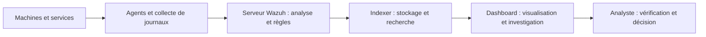
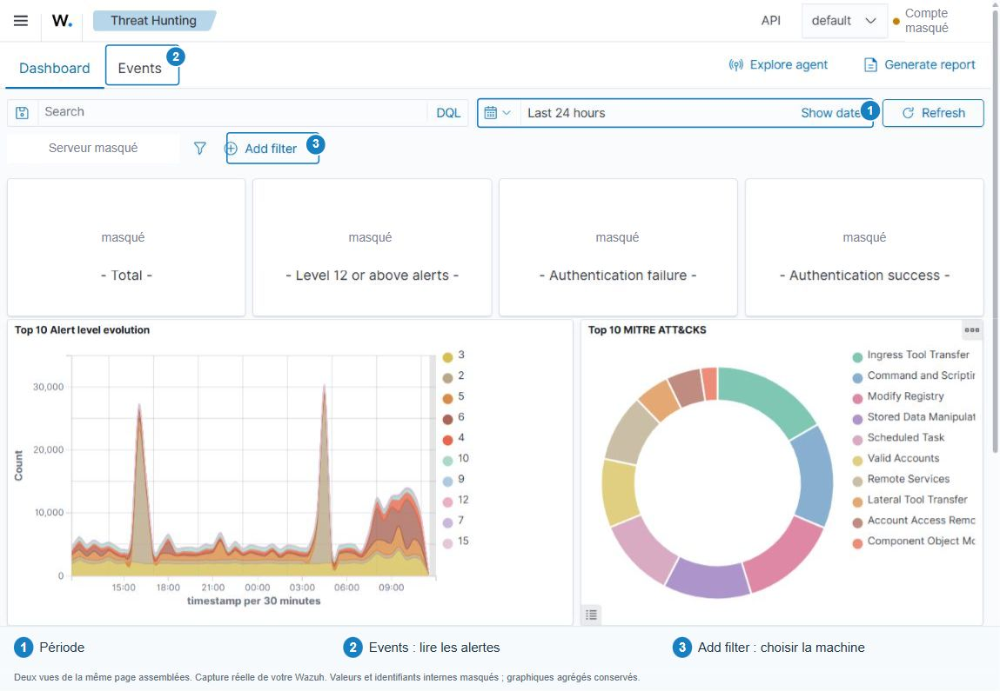
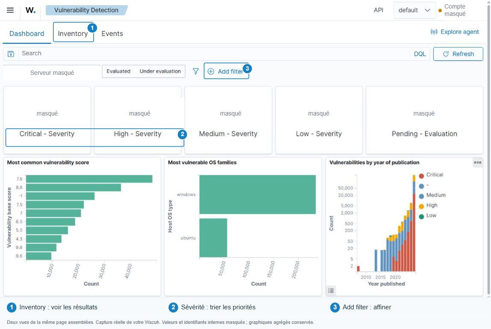
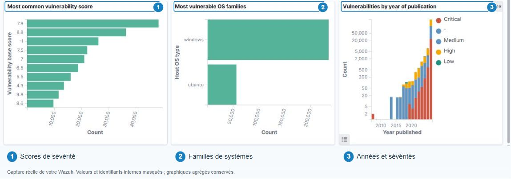
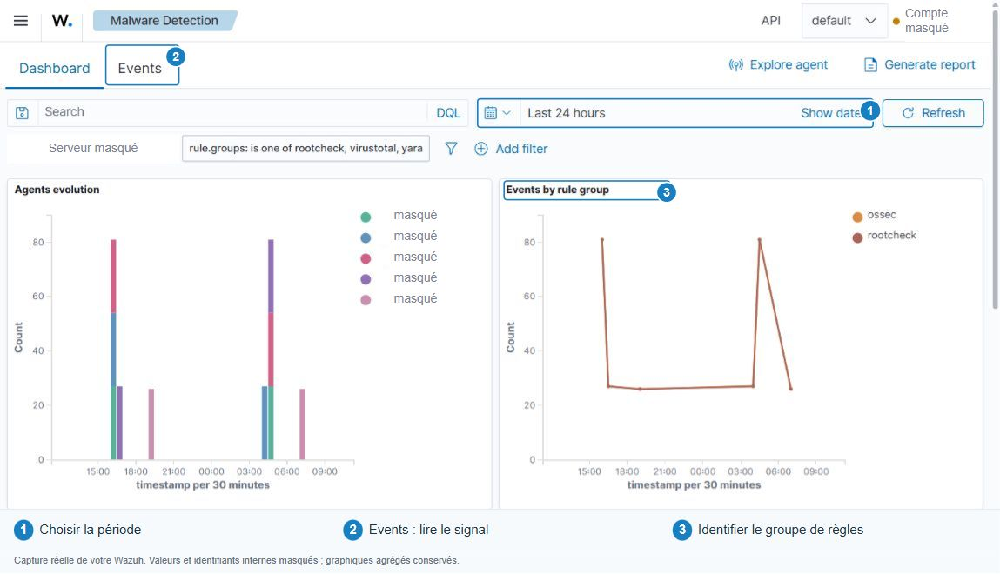
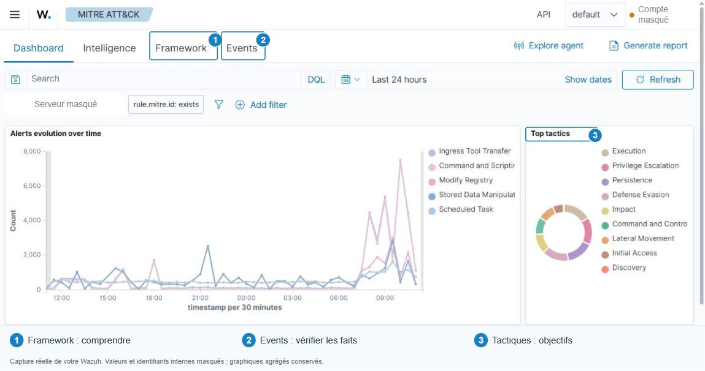

# Comprendre Wazuh — guide pratique en français

Wazuh est une plateforme de cybersécurité open source. Elle rassemble des informations de sécurité provenant des machines et services, les analyse et permet d'enquêter depuis une interface centrale. Elle propose des fonctions SIEM et XDR.

**SIEM** signifie centraliser et analyser des journaux de sécurité. **XDR** désigne la détection et la réponse à partir de plusieurs sources de données. Wazuh aide à repérer et comprendre les problèmes ; les actions automatiques dépendent de sa configuration.

**À quoi ça sert ?** Repérer des comportements suspects, suivre les vulnérabilités, surveiller les fichiers et vérifier les configurations de sécurité. Une alerte est un signal à examiner : elle ne prouve pas automatiquement une attaque.

## Comment ça fonctionne ?

L'agent collecte les informations sur une machine. Le serveur Wazuh les analyse. L'indexer stocke les données consultables. Le dashboard est l'interface web utilisée pour explorer les résultats. [Architecture officielle](https://documentation.wazuh.com/current/getting-started/components/index.html).

## Les pages à connaître

| Page | Question à laquelle elle répond | Première action utile |
| --- | --- | --- |
| Threat Hunting | Que s'est-il passé ? | Choisir une période puis examiner Events |
| Vulnerability Detection | Quels logiciels présentent des failles connues ? | Consulter Inventory et filtrer la gravité |
| Malware Detection | Quels signaux peuvent indiquer un logiciel malveillant ? | Examiner les événements et leur source |
| MITRE ATT&CK | À quelle technique d'attaque correspond une alerte ? | Relier une technique aux Events |
| File Integrity Monitoring | Quels fichiers ont changé ? | Examiner le chemin et la nature du changement |
| Configuration Assessment | La configuration respecte-t-elle les contrôles ? | Ouvrir les contrôles échoués d'un agent |
| IT Hygiene | Quels systèmes, logiciels et processus sont présents ? | Examiner l'inventaire de la machine |

**[Commencer avec des exemples simples](docs/parcours-debutant.md)** · **[Guide des pages](docs/guide-pages.md)** · **[Glossaire simple](docs/glossaire.md)** · **[Démonstration en 10 minutes](docs/demo.md)**

Pour débuter, suivez le parcours avec des exemples fictifs, puis utilisez le guide des pages pour retrouver les boutons. Ce dépôt présente l'interface et les concepts ; il ne fournit pas une installation ou une configuration prête à déployer.

## Captures de l'interface

Captures réelles réalisées le 12 octobre 2026, vérifiées visuellement après export. Les repères bleus **1, 2 et 3** indiquent les commandes ou panneaux à lire ; leur légende se trouve sous chaque image. Les masques couvrent les valeurs et identifiants internes sans cacher les intitulés des cartes. Les vues Threat Hunting et Vulnerability Detection assemblent le haut de la page et ses graphiques après défilement ; ce montage est indiqué dans l'image. Les lignes détaillées de vulnérabilités sont exclues. Les graphiques agrégés restent visibles. Cliquez sur une image pour l'afficher en grand.

**Traduction des boutons :** Dashboard = vue d'ensemble ; Events = liste des événements ; Inventory = inventaire ; Add filter = ajouter un filtre ; Refresh = actualiser ; Last 24 hours = dernières 24 heures.

### Threat Hunting

**Repères :** **1** choisit la période ; **2** ouvre les événements ; **3** permet de filtrer une machine.

**À faire :** choisissez une période, cliquez sur **Events**, puis recherchez une machine. Ouvrez un événement et lisez son heure et son message. Vérifiez avec l'utilisateur ou l'administrateur si l'activité était prévue.

**À regarder :** un pic dans le graphique indique davantage d'alertes à ce moment. Le graphique circulaire présente les techniques associées aux alertes. Un pic n'est pas une preuve d'attaque, et une alerte peut être associée à plusieurs techniques.

### Vulnerability Detection

**Repères :** **1** ouvre Inventory ; **2** montre les catégories de sévérité à examiner en premier ; **3** permet d'affiner les résultats.

**À faire :** cliquez sur **Inventory**, filtrez les résultats **Critical** ou **High**, puis ouvrez le détail d'une ligne. Repérez la machine, le logiciel, sa version et la CVE. Vérifiez le correctif dans l'avis de l'éditeur et faites appliquer la mise à jour selon la procédure habituelle. Revenez ensuite vérifier le résultat.

**À regarder :** Critical = critique ; High = élevée ; Medium = moyenne ; Low = faible. La gravité aide à choisir par où commencer, mais une machine exposée ou importante peut être prioritaire.

**Lire les graphiques :** à gauche, les scores de sévérité les plus fréquents ; au centre, la répartition par famille de système ; à droite, les résultats selon l'année de publication et la sévérité. Ces graphiques servent à explorer et prioriser les résultats ; leurs totaux ne représentent pas forcément des CVE uniques.

### Malware Detection

**Repères :** **1** choisit la période ; **2** ouvre les événements ; **3** montre leur répartition par groupes de règles.

**À faire :** choisissez la période et cliquez sur **Events**. Ouvrez une alerte, lisez la machine, l'heure et le message, puis identifiez la source du signal. Faites vérifier le fichier ou l'activité avec les outils de sécurité de l'organisation ; prévenez l'équipe responsable si le doute persiste.

**À regarder :** les graphiques montrent quand les signaux apparaissent et à quels groupes de règles ils appartiennent. Rootcheck recherche des anomalies ; YARA et VirusTotal sont des intégrations possibles qui nécessitent une configuration. Ne supprimez pas un fichier sur la seule base du graphique.

### MITRE ATT&CK

**Repères :** **1** ouvre Framework ; **2** ouvre les événements ; **3** présente les tactiques associées aux alertes.

**À faire :** ouvrez **Framework** pour découvrir une technique, puis **Events** pour lire les alertes associées. Regardez le message et le contexte de la machine avant de conclure.

**À comprendre :** une tactique est un objectif, par exemple rester sur une machine. Une technique est le moyen utilisé pour y parvenir. MITRE ATT&CK donne un vocabulaire commun pour expliquer les comportements ; il ne bloque pas les attaques.

## Ce que Wazuh permet, et les limites à comprendre

La détection dépend des sources collectées, règles, modules et intégrations configurés. Afficher une page Malware Detection ne garantit pas qu'une intégration YARA ou VirusTotal est activée. Une page vide peut aussi venir de la période sélectionnée, des filtres ou d'un problème de collecte.

Une vulnérabilité détectée ne signifie pas qu'elle a été exploitée. Un événement associé à MITRE ATT&CK ne suffit pas à attribuer une attaque. Les vues de conformité aident à examiner des contrôles ; elles ne constituent pas une certification.

**Trois distinctions utiles :** un événement est un fait enregistré ; une alerte est un résultat de détection à examiner ; un incident est une situation qualifiée qui nécessite un traitement. Le niveau d'une règle Wazuh aide au tri des alertes. Le score CVSS mesure la sévérité d'une vulnérabilité. Le risque dépend aussi du contexte de l'organisation.

## Périmètre du guide

Les quatre modules principaux ont été consultés dans l'interface pour vérifier les onglets et commandes présentés. FIM, Configuration Assessment, IT Hygiene et conformité sont décrits pour donner une vue d'ensemble ; ils ne disposent pas ici d'un tutoriel illustré complet. Les noms des boutons et les champs disponibles peuvent varier selon la version, les droits et la configuration. Aucun numéro de version Wazuh n'est affirmé sans vérification.

## Sources

- [Documentation Wazuh](https://documentation.wazuh.com/current/index.html)
- [Threat Hunting](https://documentation.wazuh.com/current/getting-started/use-cases/threat-hunting.html)
- [Vulnerability Detection](https://documentation.wazuh.com/current/user-manual/capabilities/vulnerability-detection/index.html)
- [Malware Detection](https://documentation.wazuh.com/current/user-manual/capabilities/malware-detection/index.html)
- [MITRE ATT&CK dans Wazuh](https://documentation.wazuh.com/current/user-manual/ruleset/mitre.html)
- [Référentiel MITRE ATT&CK](https://attack.mitre.org/)

Ce dépôt est une présentation pédagogique indépendante. Wazuh et MITRE ATT&CK appartiennent à leurs titulaires respectifs.
