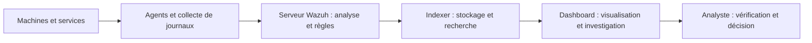

# Comprendre Wazuh — guide pratique en français

Wazuh est une plateforme de cybersécurité open source. Elle rassemble des informations de sécurité provenant des machines et services, les analyse et permet d'enquêter depuis une interface centrale. Elle propose des fonctions SIEM et XDR.

**À quoi ça sert ?** Repérer des comportements suspects, suivre les vulnérabilités, surveiller les fichiers et vérifier les configurations de sécurité. Une alerte est un signal à examiner : elle ne prouve pas automatiquement une attaque.

## Comment ça fonctionne ?

L'agent collecte les informations sur une machine. Le serveur Wazuh les analyse. L'indexer stocke les données consultables. Le dashboard est l'interface web utilisée pour explorer les résultats. [Architecture officielle](https://documentation.wazuh.com/current/getting-started/components/index.html).

## Les pages à connaître

| Page | Question à laquelle elle répond | Première action utile |
| --- | --- | --- |
| Threat Hunting | Que s'est-il passé ? | Choisir une période puis examiner Events |
| Vulnerability Detection | Quels logiciels présentent des failles connues ? | Consulter Inventory et filtrer la gravité |
| Malware Detection | Quels signaux peuvent indiquer un logiciel malveillant ? | Examiner les événements et leur source |
| MITRE ATT&CK | À quelle technique d'attaque correspond une alerte ? | Relier une technique aux Events |
| File Integrity Monitoring | Quels fichiers ont changé ? | Examiner le chemin et la nature du changement |
| Configuration Assessment | La configuration respecte-t-elle les contrôles ? | Ouvrir les contrôles échoués d'un agent |
| IT Hygiene | Quels systèmes, logiciels et processus sont présents ? | Examiner l'inventaire de la machine |

**[Ouvrir le guide des pages](docs/guide-pages.md)** · **[Glossaire simple](docs/glossaire.md)** · **[Démonstration en 10 minutes](docs/demo.md)**

## Captures de l'interface

Captures réelles réalisées le 12 octobre 2026. Les cadrages montrent les commandes utiles et excluent les données opérationnelles, noms des machines, versions installées et vulnérabilités internes. Ce sont des extraits d'interface, pas des tableaux de bord complets. Les intitulés peuvent varier avec la version et les droits du compte.

### Threat Hunting

**Repères :** Dashboard donne la vue d'ensemble ; Events permet l'investigation ; Search filtre les données ; Last 24 hours définit la période ; Refresh applique la recherche.

### Vulnerability Detection

**Repères :** Dashboard résume les résultats ; Inventory liste les associations machine, logiciel et vulnérabilité ; Events présente les événements associés.

### Malware Detection

**Repères :** définir la période, consulter Dashboard, puis ouvrir Events pour vérifier les signaux et leur origine.

### MITRE ATT&CK

**Repères :** Dashboard résume les alertes associées ; Intelligence et Framework fournissent le contexte du référentiel ; Events revient aux faits observés.

## Ce que Wazuh permet, et les limites à comprendre

La détection dépend des sources collectées, règles, modules et intégrations configurés. Afficher une page Malware Detection ne garantit pas qu'une intégration YARA ou VirusTotal est activée. Une page vide peut aussi venir de la période sélectionnée, des filtres ou d'un problème de collecte.

Une vulnérabilité détectée ne signifie pas qu'elle a été exploitée. Un événement associé à MITRE ATT&CK ne suffit pas à attribuer une attaque. Les vues de conformité aident à examiner des contrôles ; elles ne constituent pas une certification.

## Sources

- [Documentation Wazuh](https://documentation.wazuh.com/current/index.html)
- [Threat Hunting](https://documentation.wazuh.com/current/getting-started/use-cases/threat-hunting.html)
- [Vulnerability Detection](https://documentation.wazuh.com/current/user-manual/capabilities/vulnerability-detection/index.html)
- [Malware Detection](https://documentation.wazuh.com/current/user-manual/capabilities/malware-detection/index.html)
- [MITRE ATT&CK dans Wazuh](https://documentation.wazuh.com/current/user-manual/ruleset/mitre.html)
- [Référentiel MITRE ATT&CK](https://attack.mitre.org/)

Ce dépôt est une présentation pédagogique indépendante. Wazuh et MITRE ATT&CK appartiennent à leurs titulaires respectifs.
